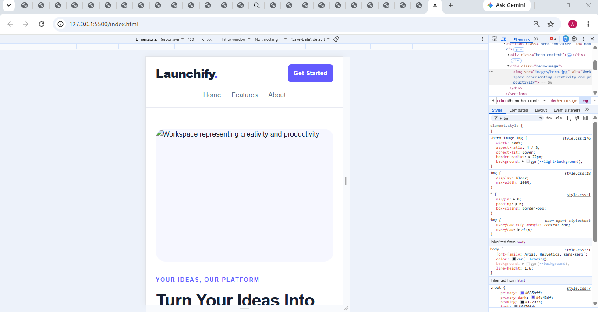
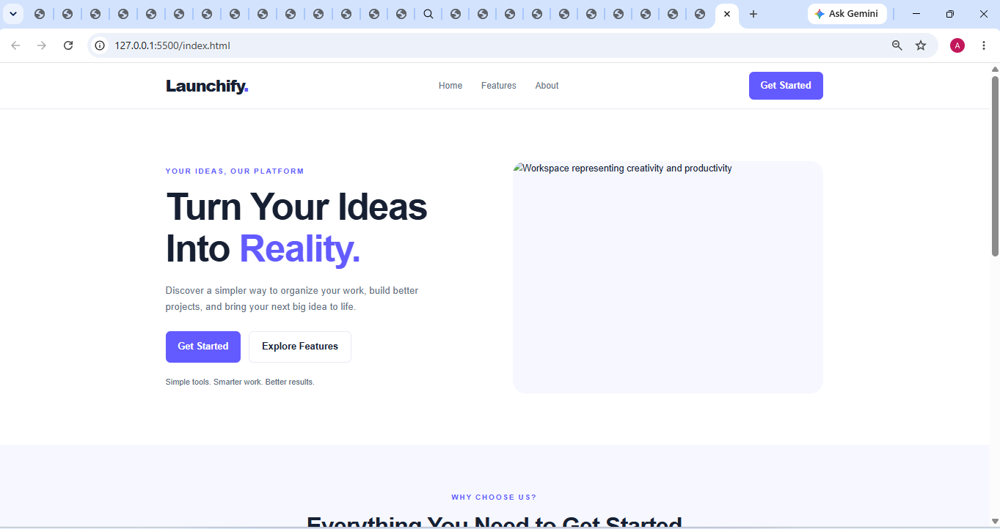

# Assignment 9.4 — Responsive Landing Page: Build

Aim: To create the initial desktop version of a modern landing page using HTML5, CSS3, CSS Grid, and Flexbox, with a structure that can later be adapted for mobile screens.

## 1. Design choices

Primary color — Purple

Hex: `#635BFF` — used for buttons, highlights, and branding.

Heading color — Dark navy

Hex: `#172033` — creates contrast for headings.

Section background — Light lavender

Hex: `#F6F7FF` — separates the features section from the rest of the page.

## 2. Important concepts used

| Concept             | Purpose                                                                         |
| ------------------- | ------------------------------------------------------------------------------- |
| Semantic HTML       | Organizes the page into header, navigation, main content, sections, and footer. |
| CSS Grid            | Creates the two-column hero layout and feature-card layout.                     |
| Flexbox             | Aligns navigation links, buttons, and footer content.                           |
| CSS variables       | Makes colors easy to reuse and update.                                          |
| `clamp()`           | Adjusts heading sizes based on screen width.                                    |
| Media queries       | Change layouts for smaller screens.                                             |
| `object-fit: cover` | Keeps images filling their containers neatly.                                   |

## SREENSHOT OF MOBILE LAYOUT

## SREENSHOT OF DESKTOP LAYOUT
